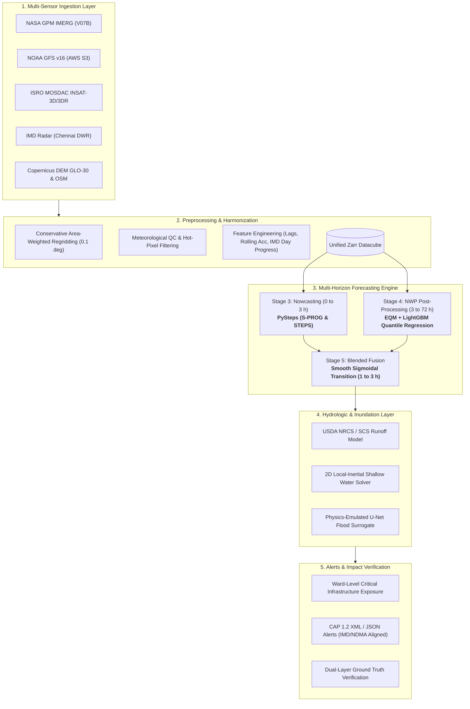

# System Architecture and Component Specifications

The **SIH26071 Early Warning and Inundation Prediction System (REWS)** is structured as a modular, physics-informed hydrometeorological pipeline designed for operational forecasting across lead times from minutes to 72 hours.

---

## 1. High-Level System Architecture

---

## 2. Stage 3 Nowcaster Scoping & Scientific Rationale

### Approved Design Decision
Stage 3 is scoped exclusively to **PySteps** (deterministic S-PROG optical flow extrapolation and probabilistic STEPS / LINDA ensemble perturbation).

### Deep Learning Nowcasting (ConvLSTM / U-Net) Documented as Future Work
Deep spatio-temporal neural networks (such as ConvLSTM, PredRNN, or U-Net nowcasters) were evaluated and explicitly deferred as future work for the following technical reasons:
1. **Time Scope and Storm Sample Regimes**: Training high-capacity recurrent spatio-temporal architectures without severe spatial blurring or mode collapse requires multi-year continuous sequences across hundreds of independent convective events, requiring training and tuning cycles outside the timeline of this hackathon submission.
2. **Effective Spatial Resolution vs. Convective Cell Scales**: At the 0.1° (~10 km) grid resolution of satellite precipitation products (IMERG), fine convective storm initiation and cellular decay cannot be resolved by neural recurrence; semi-Lagrangian optical flow advection with spectral autoregressive cascades (PySteps S-PROG / STEPS) represents the established operational meteorological benchmark for this scale.
3. **Marginal Value and Operational Robustness**: PySteps requires zero offline parameter fitting, runs inference in <2 seconds on standard CPU infrastructure, avoids the unphysical blur of $L_1/L_2$ regression losses, and generates calibrated probabilistic ensembles directly from recent radar/satellite motion fields.
